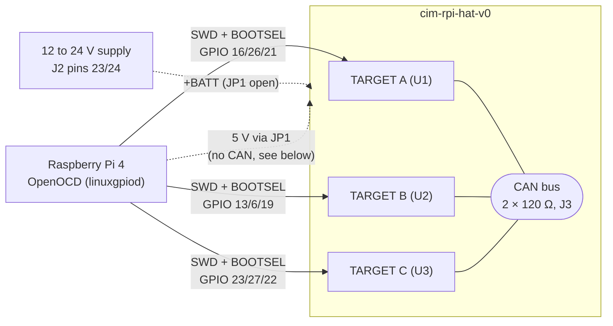

# HIL test bench

The hardware-in-the-loop (HIL) bench runs firmware tests on real CIMs: a Raspberry Pi 4 flashes and debugs up to three CIMs over SWD and talks to them over a shared CAN bus.

> [!WARNING]
> **Open JP1 before connecting 12 V to J2.** JP1 is bridged by default and connects the Pi's 5 V rail to `+BATT`. With JP1 bridged, 12 V on J2 reaches the Pi and destroys it.

## Hardware

- Raspberry Pi 4 (2 GB is enough)
- HAT `cim-rpi-hat-v0` ([cim-hardware](https://github.com/AMZ-Racing/cim-hardware), `cim-rpi-hat-v0/`)
- Up to three CIMs (proto v7) in slots TARGET A, B and C



### Pinout

| Slot | Ref | SWDIO | SWCLK | BOOTSEL | Mezzanine GPIO22–29 |
|---|---|---|---|---|---|
| TARGET A | U1 | GPIO16 | GPIO26 | GPIO21 | not connected |
| TARGET B | U2 | GPIO13 | GPIO6 | GPIO19 | Pi GPIO 5, 7, 8, 11, 25, 9, 10, 24 (incl. Pi SPI0) |
| TARGET C | U3 | GPIO23 | GPIO27 | GPIO22 | header J2 |

All numbers are Pi BCM GPIOs on `gpiochip0`. The CIMs' USB is not routed on the HAT; connect a CIM's own USB-C to a USB port of the Pi instead. That is safe while it sits in a slot: on proto v7, `+BATT` (D10) and USB VBUS (D60) are diode-ORed. Over USB the Pi gets the CIM's serial port (`/dev/serial/by-id/usb-Raspberry_Pi_Pico_*`) and, in BOOTSEL mode, `picotool`.

When a slot's CIM is powered and idle, its SWDIO, SWCLK and BOOTSEL lines read high (`gpioget -c gpiochip0 16 26 21`). If they read low, the slot is empty or not powered.

### Power

`+BATT` of all slots comes either from J2 pins 23/24 or, through JP1, from the Pi's 5 V.

| Supply | JP1 | Use |
|---|---|---|
| Pi 5 V | bridged (default) | SWD only. The TCAN reports undervoltage (UVSUP) and does not enter Normal mode, so **no CAN**. |
| 12 V to 24 V on J2 | **open** | Everything, including CAN. A 20 V USB-C PD adapter works. |

## Raspberry Pi setup

1. Write **Raspberry Pi OS Lite (64-bit)** with [Raspberry Pi Imager](https://www.raspberrypi.com/software/). In the OS customisation, set:
   - hostname (e.g. `cim-hil`) and user (e.g. `hil`)
   - SSH with public-key authentication only
   - network
2. Boot the Pi **without the HAT** and log in over SSH.
3. Copy [`hil/setup-pi.sh`](../../hil/setup-pi.sh) to the Pi, run it as the HIL user, then reboot:
   ```sh
   scp hil/setup-pi.sh cim-hil:
   ssh -t cim-hil ./setup-pi.sh && ssh cim-hil sudo reboot
   ```
   The script installs git, python3-venv, OpenOCD, gpiod, picotool and i2c-tools, adds the user to the `gpio`, `i2c`, `plugdev` and `dialout` groups, enables I2C (for the status display) and checks that OpenOCD has the `linuxgpiod` adapter.
4. Switch the Pi off, put the HAT on and the CIMs in. Check the power table above before applying 12 V.

## SWD check

The Raspberry Pi build of OpenOCD drives SWD directly from the Pi's GPIOs. For TARGET B:

```sh
openocd -c "adapter driver linuxgpiod" \
        -c "adapter gpio swclk 6 -chip 0" -c "adapter gpio swdio 13 -chip 0" \
        -c "transport select swd" -f target/rp2040.cfg \
        -c init -c halt -c "reg pc" -c "rp2040.core0 resume" -c shutdown
```

A working slot prints `SWD DPIDR 0x0bc12477` and `Examination succeed` for both cores. `program <file>.elf verify reset exit` flashes a board in about 6 s.

## CI: self-hosted runner

The `hil` job in [`.github/workflows/build.yml`](../../.github/workflows/build.yml) runs the [HIL tests](../../hil/runner/README.md) on the bench after the firmware build. It runs on a GitHub Actions runner on the Pi with the label `hil`.


> [!CAUTION]
> The repository is public, and a self-hosted runner executes the repository's code on the Pi. Therefore:
> - The `hil` job runs only for pushes to `main` and manual runs (`workflow_dispatch`), never for pull requests.
> - Fork pull requests need approval for all external contributors (Settings → Actions → General). Never approve a fork PR that changes workflows or uses `runs-on: [self-hosted, hil]` without reading it.
> - The runner runs as its own user `gh-runner` without sudo, with access to GPIO, I2C, USB and serial ports only.

### Set up the runner

On the Pi, as the HIL user. Take the version and SHA-256 from GitHub (Settings → Actions → Runners → New self-hosted runner, Linux, **ARM64**); the token is valid for one hour.

```sh
# user without sudo, hardware groups only
sudo useradd -m -s /usr/sbin/nologin -G gpio,i2c,plugdev,dialout gh-runner

# download, check, extract (as gh-runner)
sudo -u gh-runner -H bash -c '
  mkdir -p ~/actions-runner && cd ~/actions-runner &&
  curl -fsSL -o runner.tar.gz https://github.com/actions/runner/releases/download/v<version>/actions-runner-linux-arm64-<version>.tar.gz &&
  echo "<sha256>  runner.tar.gz" | sha256sum -c &&
  tar xzf runner.tar.gz'
sudo /home/gh-runner/actions-runner/bin/installdependencies.sh

# register; asks for the token, so it does not end up in the shell history
sudo -u gh-runner -H bash -c 'cd ~/actions-runner && ./config.sh --url https://github.com/bluuas/cim --name cim-hil --labels hil'

# systemd service
sudo bash -c 'cd /home/gh-runner/actions-runner && ./svc.sh install gh-runner && ./svc.sh start'
```

The runner then shows as *Idle* under Settings → Actions → Runners. To run the HIL tests by hand: Actions → build → *Run workflow*.

## Known boards

The three proto v7 boards are assembled differently and have a history of bad solder joints at the mezzanine connector J1. Positions as of 2026-10-11; do not swap them, the connector is rated for 50 mating cycles.

| Board | Assembly | Slot | State |
|---|---|---|---|
| "cut" | breakaway part cut off: no USB, no BOOTSEL button, no SWD pads | B | defective RP2040 hardware divider (#41): large divisions return wrong results, so no firmware tests on it; CAN, SWD and power are fine. A good chip prints `q=0x00022e09 r=0x00000001` in the divider test of #41, this one `q=0x00022fff r=0x0000e347`. |
| "full" | fully assembled, UID `E66208F4176B6B38` | C | all good after resoldering J1: +BATT, SWD and CAN. Before, the +BATT path sagged under load (`tcan_init()` returned `TCAN_ERR_NO_VSUP` while the idle `tcan_probe` saw no undervoltage), SWD answered only WAIT, and CAN showed the stuck-stub signature below. |
| "noUSB" | USB-C connector not populated | A | not reachable over SWD at the moment (lines low: unpowered or not seated). Its CAN showed the stuck-stub signature: never transmits, REC 127 with stuff errors, hears nothing. Check J1 pins 11/12. |

A board whose CANH/CANL do not reach the terminated bus (open J1 pins 11/12) drives only its own C51/C52; the line returns to recessive slower than one bit at 500 kbit/s, the node loses arbitration against its own SOF and then counts stuff errors as a receiver (TEC 0, REC 127). The TCAN's bus-fault flags do not show it.
